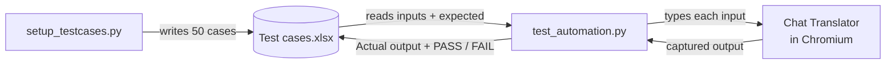

<h1 align="center">🛡️ Translator Negative & Boundary Test Suite</h1>

<p align="center">
  50 data-driven negative tests that try to break a Singlish → Sinhala chat translator:
  injection attacks, emojis, foreign scripts, empty input, huge input and more.
  Test cases live in Excel; the script runs them in a real browser and writes the results back.
</p>

<p align="center">
  
  
  
</p>

<!-- TODO: record a GIF of a test run, save as docs/demo.gif, then uncomment:

-->

---

## ✨ How it works



- **Data-driven:** test cases are rows in a spreadsheet, so new cases need no code changes.
- **Flexible column detection:** the script finds input / expected / actual / status columns by common header names, or you pass them as flags.
- **Resilient runs:** configurable waits, retries, typing delay, headless mode, and saving progress every N rows so a crash doesn't lose results.

---

## 🎯 What it covers

| Category | Count |
|---|---|
| Empty / whitespace | 4 |
| Special characters | 6 |
| Very long input | 6 |
| Script injection (XSS / SQL / HTML) | 6 |
| Non-Singlish languages | 6 |
| Gibberish / keyboard mash | 5 |
| Mixed scripts (Sinhala + Singlish) | 5 |
| Numbers only | 5 |
| Encoding / Unicode edge cases | 4 |
| Formatting / control characters | 3 |
| **Total** | **50** |

Target: [PixelsSuite Chat Translator](https://www.pixelssuite.com/chat-translator)

---

## 🚀 Run it

```bash
git clone https://github.com/Gagana0819/ITPM-assignment-IT23685116-.git
cd ITPM-assignment-IT23685116-
pip install playwright openpyxl
python -m playwright install chromium

python setup_testcases.py          # fill the Excel file (close it in Excel first)
python test_automation.py \
  --excel "Assignment 1 - Test cases.xlsx" \
  --input-col "Input" \
  --expected-col "Expected output" \
  --actual-col "Actual output" \
  --status-col "Status" \
  --save-every 1
```

Useful flags: `--headless`, `--wait-ms`, `--retries`, `--type-delay-ms`, `--slow-mo-ms`, `--url`.

---

## 💡 What I learned & what I'd improve

**Learned**
- Good negative testing is about thinking like an attacker or a careless user: XSS payloads, emojis and very long inputs find bugs that happy-path tests never will.
- Keeping test data separate from test code makes a suite easier for non-developers to review.

**Next improvements**
- [ ] Fix the default Excel path so the script runs without `--excel`
- [ ] Add a `requirements.txt`
- [ ] Run headless in a GitHub Actions workflow and upload the updated Excel file as an artifact
- [ ] Move to `pytest` + `pytest-playwright` with parametrised tests

---

<sub>Built for IT3040 IT Project Management & Quality Assurance (SLIIT).</sub>
